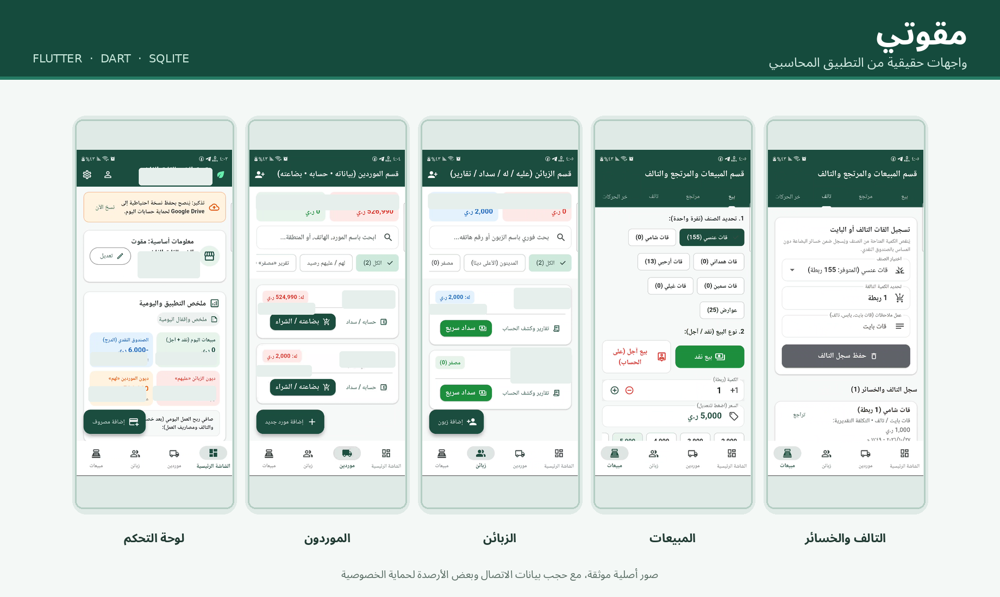

# مقوتي | Maqwati

**تطبيق محاسبي عربي لإدارة المبيعات والمخزون والحسابات اليومية**

**المطور:** وهيب الكبودي | Wahib Al-Kaboudi  
**المنصة:** Android  
**التقنيات:** Flutter · Dart · Riverpod · Drift · SQLite

## نبذة عن التطبيق

مقوتي تطبيق مخصص لتبسيط العمليات المحاسبية اليومية للأنشطة التجارية الصغيرة. يتيح إدارة البيع والشراء والديون والمخزون والمصاريف من خلال واجهات عربية وتخزين محلي.

## الوظائف الأساسية

- تسجيل المبيعات النقدية والآجلة وإدارة الأصناف والكميات.
- متابعة حسابات الموردين والزبائن والديون والتحصيلات.
- إدارة المخزون والمرتجعات والتالف وتكلفة البضاعة المباعة.
- تسجيل مصاريف العمل والمصاريف الشخصية.
- عرض الملخصات والتقارير المالية اليومية.
- دعم التخزين المحلي وخيارات النسخ الاحتياطي والحماية.

## صور التطبيق



| الواجهة | الصورة |
|---|---|
| الرئيسية والملخص اليومي | [عرض](screenshots/01-home-dashboard.png) |
| الإعدادات والنسخ الاحتياطي | [عرض](screenshots/02-backup-security.png) |
| العمليات الأخيرة والمصاريف | [عرض](screenshots/03-recent-operations.png) |
| مصاريف العمل | [عرض](screenshots/04-work-expense.png) |
| الموردون | [عرض](screenshots/05-suppliers.png) |
| إضافة مورد | [عرض](screenshots/06-add-supplier.png) |
| الزبائن | [عرض](screenshots/07-customers.png) |
| إضافة زبون | [عرض](screenshots/08-add-customer.png) |
| المبيعات | [عرض](screenshots/09-sales.png) |
| تسجيل التالف | [عرض](screenshots/10-wastage.png) |

## البنية التقنية

يعتمد المشروع على Flutter للواجهات العربية، وRiverpod لإدارة الحالة، وDrift/SQLite لحفظ البيانات محليًا ومعالجة العمليات المرتبطة بالمخزون والحسابات.

## التشغيل

يتطلب Flutter SDK وAndroid SDK. من جذر المشروع:

```bash
flutter pub get
flutter run
```

## حالة المشروع

المستودع يعرض نسخة تطويرية من التطبيق. ينبغي اختبار النسخ السحابي والبصمة وإعدادات توقيع إصدار الإنتاج قبل الاستخدام التجاري الفعلي.

## حقوق النشر

Copyright © 2026 Wahib Al-Kaboudi. All rights reserved.

جميع الحقوق محفوظة. لا يمنح نشر الكود المصدري إذنًا عامًا بإعادة توزيعه أو استخدامه تجاريًا. تبقى تراخيص المكونات الخارجية سارية حسب شروطها.
