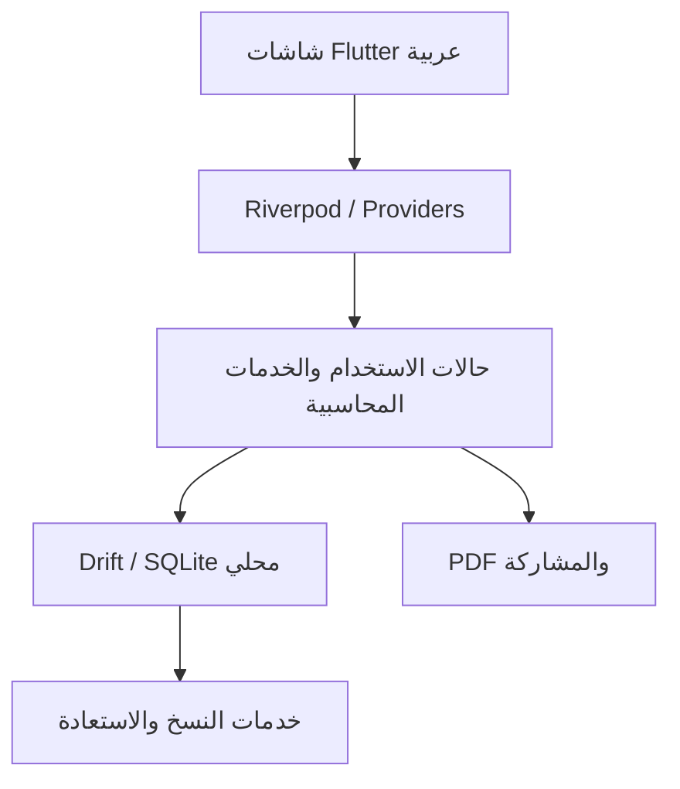

# مقوتي | Maqwati 🌿

### إدارة البيع والشراء والديون والمخزون في تطبيق عربي واحد

**مقوتي** تطبيق محاسبي مخصص لاحتياجات البائعين والتجار الصغار في سوق القات اليمني. يحوّل الحركات اليومية — من شراء البضاعة وبيعها نقدًا أو آجلًا إلى متابعة حقوق الموردين والزبائن والمصاريف والمرتجعات — إلى سجلات منظمة يمكن الرجوع إليها ومراجعتها.

**تطوير:** وهيب الكبودي — **النسخة المصدرية:** `1.0.0+1` — **المنصة:** Android (Flutter)

`Flutter` · `Dart` · `Riverpod` · `Drift + SQLite` · `Arabic RTL` · `Offline-first`

> **حالة المشروع:** نموذج برمجي متقدم للتوثيق وعرض الأعمال. سُجّل نجاح 20 اختبار محاسبة/قاعدة بيانات وبناء Android تجريبي بتاريخ 28 أكتوبر 2026 في تقارير التطوير السابقة؛ لم أُعد إجراء هذه الاختبارات ضمن إعداد نسخة GitHub. بعض عمليات الهاتف وGoogle Drive والبصمة ما زالت بحاجة إلى تحقق ميداني قبل الاستخدام الإنتاجي.

## لماذا بنيت مقوتي؟

يعتمد كثير من البائعين على دفاتر متناثرة أو حسابات ذهنية عند تسوية قيمة البضاعة والديون والمبالغ المقبوضة نقدًا أو بالحوالة. هذا يجعل معرفة الرصيد الفعلي والأرباح وحالة كل طرف أمرًا مرهقًا. يهدف **مقوتي** إلى تبسيط هذا العمل اليومي عبر واجهات عربية ومصطلحات قريبة من السوق المحلي، مع تخزين محلي يسمح بالعمل حتى عند ضعف الإنترنت.

## المميزات المنفذة في الكود

| المجال | ما يقدمه التطبيق |
|---|---|
| **المبيعات** | تسجيل بيع نقدي وآجل، اختيار الأصناف والكميات، متابعة سجل العمليات، ومعالجة المرتجعات الجزئية والكاملة |
| **المشتريات والموردون** | إدخال البضاعة، تسجيل المدفوع والمتبقي، سداد حساب المورد، ومتابعة بضاعته وكشفه |
| **الزبائن والديون** | إدارة حسابات العملاء وأرصدتهم، تسجيل التحصيلات، وعرض كشوف الحساب |
| **المخزون والتكلفة** | تتبع الكميات، متوسط تكلفة متحرك، وتسجيل تكلفة البضاعة المباعة **COGS** والتالف |
| **الربح والمصاريف** | فصل مصاريف العمل عن المصاريف الشخصية، وحساب الربح بناءً على المبيعات وتكلفتها بدل خلطه بالتدفق النقدي |
| **الخزينة** | الفصل بين النقد والحوالة والتحويل الداخلي بينهما دون تسجيل ربح وهمي |
| **التقارير والمشاركة** | ملخصات مالية وكشوف PDF وخيارات المشاركة بواسطة تطبيقات الهاتف |
| **حماية البيانات** | PIN محلي، دعم برمجي للبصمة، وآليات نسخة احتياطية واستعادة مع فحوص سلامة SQLite |

**الموثوقية المحاسبية:** السجلات القديمة التي تفتقر إلى تكلفة موثقة تُعلّم بحالة `UNKNOWN` بدل إعطائها تكلفة افتراضية. العمليات المترابطة تستخدم معاملات SQLite، مع مفاتيح طلب لمنع تكرار بعض المعاملات.

## لقطات حقيقية من التطبيق

تم التقاط هذه الصور من تطبيق **مقوتي المتقدم** أثناء تشغيله على هاتف Android. تُعرض هنا لقطات أصلية وليست صورًا مولّدة أو نماذج تصميم، وقد **حُجبت أسماء وأرقام اتصال وأرصدة محددة** مراعاة للخصوصية. وتثبت الصور وجود الواجهات، لكنها لا تمثل اختبارًا آليًا لكل وظيفة.


### استعراض جميع الواجهات

| الواجهة | ماذا تعرض؟ |
|---|---|
| [لوحة التحكم وملخص اليومية](screenshots/01-home-dashboard.png) | ملخص المبيعات والصندوق والذمم |
| [الضبط والنسخ الاحتياطي](screenshots/02-backup-security.png) | خيارات النسخ والاستعادة والحماية |
| [آخر العمليات والمصاريف](screenshots/03-recent-operations.png) | قائمة الحركات الأخيرة وأقسام المصروفات |
| [تسجيل مصروف عمل](screenshots/04-work-expense.png) | تصنيفات ومبلغ وطريقة دفع المصروف |
| [الموردون والحسابات](screenshots/05-suppliers.png) | متابعة البضاعة والديون والمستحقات |
| [إضافة مورد](screenshots/06-add-supplier.png) | تسجيل بيانات مورد جديد |
| [الزبائن والأرصدة](screenshots/07-customers.png) | عرض الديون والتحصيلات وكشوف الحساب |
| [إضافة زبون](screenshots/08-add-customer.png) | بيانات الزبون وسقف الدين |
| [المبيعات](screenshots/09-sales.png) | بيع نقدي وآجل مع الأصناف والكميات |
| [تسجيل التالف](screenshots/10-wastage.png) | توثيق كميات التالف والخسائر |

**مسار الصور:** `screenshots/` — جميع الروابط نسبية، وستعمل عند رفع الصور وREADME إلى جذر المستودع نفسه.


## التقنيات والقرارات الهندسية

- **Flutter / Dart:** تطبيق Android بواجهة عربية واتجاه **RTL** مخصص للاستخدام السريع.
- **Riverpod:** مزودات حالة وتدفقات مرتبطة ببيانات محلية.
- **Drift / SQLite:** قاعدة بيانات محلية مع معاملات ذرية وعمليات ترحيل بنيوية.
- **GoRouter:** تنظيم الانتقال بين الأقسام والشاشات التفصيلية.
- **PDF / Printing / Share Plus:** إنشاء مستندات قابلة للمشاركة والطباعة.
- **Google Drive API:** شيفرة للنسخ الاحتياطي السحابي عند توفر اتصال واعتماد المستخدم، وليست جزءًا من التشغيل المحلي الأساسي.
- **Local Auth / Secure Storage:** واجهات وخدمات للحماية المحلية؛ اختبار البصمة على الأجهزة المختلفة مطلوب قبل الاعتماد الإنتاجي.

### معمارية مختصرة



```text
lib/
├── core/            # الثيم، المزودات، التنقل، الأدوات المشتركة
├── data/            # SQLite/Drift وخدمات النسخ الاحتياطي
├── domain/          # الكيانات والمعادلات وحالات الاستخدام
├── features/        # الرئيسية، الموردون، الزبائن، المبيعات، المصاريف
├── app.dart         # العربية، RTL، الثيم، التوجيه
└── main.dart        # نقطة الدخول

test/                # اختبارات المحاسبة وقاعدة البيانات والواجهات
docs/                # دراسة الحالة والقيود والتشغيل والتصوير
screenshots/         # 10 صور فعلية + معرض للواجهات
```

## التشغيل محليًا

**المتطلبات:** Flutter SDK متوافق مع `pubspec.yaml`، وAndroid SDK / Android Studio، وجهاز Android أو محاكي. الاتصال بالإنترنت قد يلزم أول مرة لتنزيل اعتماديات Gradle وPub إذا لم تكن مخزنة.

```bash
flutter pub get
flutter analyze
flutter run
```

للاختبارات المحاسبية المسجلة في التقرير السابق:

```bash
flutter test test/maqwati_accounting_test.dart test/accounting_modernization_test.dart
```

لإنشاء APK تجريبي بعد تهيئة البيئة:

```bash
flutter build apk --debug
```

**مهم:** مجلد `build/` وملفات التوقيع وقواعد البيانات الشخصية غير مرفوعة. إعداد `release` في المصدر الحالي يستخدم توقيع Debug، لذلك **ليس إعداد إصدار متجر/إنتاج جاهزًا**.

## نتائج التحقق والقيود بشفافية

- **موثق سابقًا (28 أكتوبر 2026):** نجاح **20/20** اختبار وحدة/قاعدة بيانات، ونجاح `flutter analyze` وبناء APK تجريبي.
- **لم يُتحقق منه في هذه الحزمة:** تشغيل اختبارات جديدة، عرض كل الشاشات على أجهزة فعلية، فحص البصمة، النسخ السحابي إلى Drive من البداية للنهاية، أو التحديث الآمن لقاعدة بيانات هاتف إنتاج.
- **حدود معروفة:** بعض واجهات الإقفال النقدي والعكس المحاسبي الشامل غير مكتملة، والعمليات المؤرخة للخلف غير مدعومة، كما ما تزال بعض القيم المالية من نوع SQLite `REAL` للتوافق مع الإصدارات القديمة.

اقرأ [حالة الاختبارات والقيود](docs/TEST_STATUS_AR.md) قبل اعتبار التطبيق مناسبًا للاستخدام التجاري الحقيقي.

## ما الذي يراه مسؤول التوظيف في هذا المشروع؟

هذا المشروع يعرض أكثر من واجهات هاتف: فقد جرى فيه تصميم نموذج بيانات محلي وتدفقات معاملات مالية، وفصل ذمم الأطراف عن الصندوق، واحتساب تكلفة البضاعة المباعة، وتسجيل التالف والمرتجعات، مع اختبارات تستهدف القواعد المحاسبية الحرجة. تظهر الواجهات كيف جرى تبسيط هذه المفاهيم إلى عمليات يومية واضحة للمستخدم.

## مهارات يوضحها المشروع

إنشاء واجهات عربية متخصصة، نمذجة قواعد البيانات وترحيلها دون فقد السجلات، بناء تدفقات محاسبية وحساب COGS، معالجة المعاملات والمرتجعات، فصل الحالة والعرض عن منطق الأعمال، وكتابة اختبارات قابلة للتكرار.

[دراسة حالة للتوظيف](docs/CASE_STUDY_AR.md) · [شرح المعمارية](docs/ARCHITECTURE_AR.md) · [دليل النشر](docs/GITHUB_UPLOAD_AR.md) · [وصف جاهز للسيرة الذاتية](docs/JOB_PORTFOLIO_AR.md)

## المطور والحقوق

**وهيب الكبودي | Wahib Al-Kaboudi**

هذا المستودع مقدم لغرض عرض العمل البرمجي. **لا يوجد ترخيص مفتوح المصدر مضاف**؛ حقوق الاستخدام وإعادة التوزيع لا تُمنح تلقائيًا. يمكن تحديد الترخيص لاحقًا بإذن صاحب المشروع.
